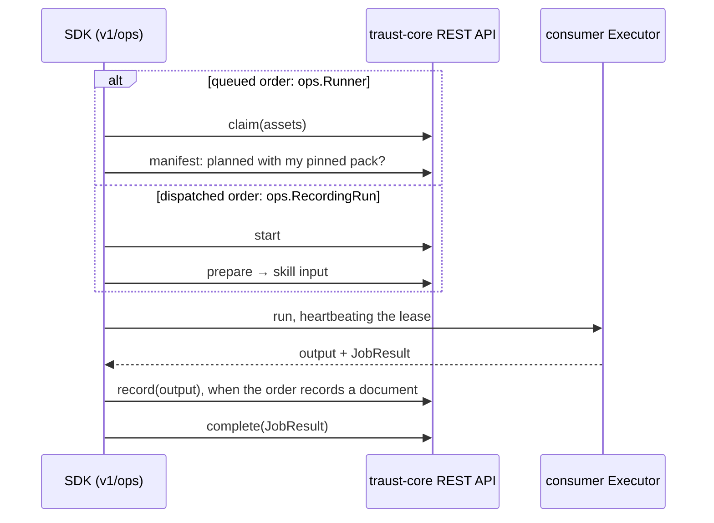

# traust-sdk

The Go SDK for traust: it does the work for the user, like a cloud provider's SDK. Every core operation is a typed call, every listing an iterator, and the run lifecycle is the SDK's; a consumer (SCI, a worker, a CI job) writes an `Executor` and a little config. Go module under `go/`; the user guide is `go/README.md`.

## Using the SDK

One client for everything you ask traust; one runner for the work you do for it.

```go
c, err := api.NewBoundClient(api.ClientConfig{BaseURL: coreURL, Tokens: api.FileTokenSource{Path: tokenPath}})
repo, err := c.GetRepository(ctx, id)                         // every operation: (T, error)
for f, err := range c.ListFindingsAll(ctx, repoID, nil) { … }  // every paged listing: an iterator
pack, err := ops.LoadPack(packYAML)
r, err := ops.NewRunner(ops.RunnerConfig{
    Client: c, Pack: pack, Executor: ops.ProcessExecutor{}, Assets: pack.Assets(),
    LeaseSeconds: 300, PollInterval: 10 * time.Second,
})
err = r.Run(ctx)
```

| I want to… | Use | Core operations |
|---|---|---|
| onboard a product and its repositories | `c` | `PlanOnboarding` (dry run) → `Onboard` |
| keep inventory current | `c` | `RegisterRef` (a commit and its branch), `SetOwners` (the teams a source reports; core stamps when ownership opens and closes) |
| look up inventory | `c` | `ListRepositories` (by `url`), `ListRefs` (by `sha`), `ListProducts`, `ListOwners`, `ListProductsOf`, `ListOwnedRepositories` |
| ask for a run (a person's token) | `c` | `Submit` with `Config: &[]api.ConfigDigest{pack.Pin()}`, the pack version it must run under |
| run queued pack commands | `ops.Runner` + `ops.ProcessExecutor` or your `Executor` | `Claim` → `GetOrderManifest` → your run → `Complete` (the runner calls these, you don't) |
| run and record a dispatched order | `ops.RecordingRun` + your `Executor` | `Start` → `Prepare*` → your run → `Record*` → `Complete` (same) |
| read what a run produced | `c` | `ListOrderAssessments` (what an order recorded), `GetAssessment`, `GetArtifact`, `GetArtifactContent`, `ListRepositoryAssessments` |
| read findings | `c` | `ListFindings`, `SummarizeFindings` (counts by severity, CWE, validity, …), `FindingTimeline`, `GetFinding`, `ListDecisions`, `AdvisoriesFor` |
| work findings (a person's token) | `c` | `ReviewQueue`, `Decide`, `Restate` |
| follow remediation | `c` | `ListWorkItems`, `PrepareRemediation`, `PrepareVerification`, `ListVerifications` |
| check the ledger | `c` | `ListLayers`, `ListEvents`, `VerifyLayer`, `Checkpoint`; core writes ledger events when records and decisions land, you never append them |
| find exposure | `c` | `GetAdvisory`, `Affected`, `PackagesAffected`, `Dependents`, `Dependencies`, `ListImpacts`, `SummarizeExposure`, `ExposureTimeline`, `FeedStatuses` |
| read validation | `c` | `ListValidationAttempts` |
| show a dashboard, rollup or export | `c` | `GetInsight` (one call for every insight: findings-rollup, exposure, sla, sarif, …) |
| react to changes | `c` | `ReadFeed` / `ReadFeedAll` |
| test code that uses the SDK | `apitest` | a fake core: `apitest.New(t)`, `Handle`, `Client()`, `Requests()` |

Counts, rollups and dashboards come from `SummarizeFindings`, `SummarizeExposure` and `GetInsight`; never compute them from listings.

Method names are core's operation ids. A long or unclear name is fixed in core's route, never by a wrapper here.

## How it works

One lifecycle, two ways in. Both hold the order's lease the same way (`v1/ops/lease.go`); nothing else in the SDK heartbeats, records or completes.



Each step is one core endpoint. A step core doesn't serve is not a step: never stand one in locally.

| Step | Core endpoint |
|---|---|
| submit (a person) | `POST /v1/orders` with the config (pack version) the order must run under |
| claim / start | `POST /v1/orders/claim` (filtered by `assets`; 204 = nothing queued) · `POST /v1/orders/start` (an explicitly dispatched order) |
| pinned pack | `GET /v1/orders/{order_id}/manifest`: a runner runs only orders planned with exactly its pack's digest |
| heartbeat | `POST /v1/orders/{order_id}/heartbeat`; a 409 means the lease is lost: stop, record nothing |
| prepare | `GET /v1/assessments/{assessment_id}/triage-input`, and each domain's input route as core adds it |
| record | `POST /v1/assessments/{assessment_id}/triage-records` · `/v1/validation-records` · `/v1/verification-records` · `/v1/assessment-records` |
| complete | `POST /v1/orders/{order_id}/complete` with `JobResult` (outcome, degraded, usage, and a `RunOrderReason` from core's closed vocabulary); repeat-safe |
| feed | `GET /v1/feed`, cursor-paged |
| config resolve, preflight | not served by core: no such step |

| Package | Owns | Consumer writes |
|---|---|---|
| `v1/api` | the client, types and enums generated from core's OpenAPI; the generated `(T, error)` calls and `…All` iterators; auth, read retries, typed problem errors | a `TokenSource` |
| `v1/api/apitest` | a fake core for consumers' tests: canned responses, recorded requests | — |
| `v1/ops` | the lease (heartbeat, lease loss, complete) and its two ways in: `Runner` (claim, pinned pack, the asset's command) and `RecordingRun` (start, prepare, record); `ProcessExecutor` | an `Executor` (or `ProcessExecutor`); the pack file |
| `v1/<pkg>/<pkg>test` | test doubles for each extension point; the conformance suite every `Executor` passes against `traust serve` | — |

Packages not in this table (`storage`, `ledger`, `skills`, `types`, `enums`, `validate`, the contracts generator in `internal/generate`) predate this shape: fix bugs, add nothing.

## Rules

- **Every change is one of four things:** an extension point the SDK calls, a lifecycle step in `ops`, a regenerated `v1/api`, or a helper that saves every consumer the same work (`ProcessExecutor`, `apitest`, a generated iterator). Anything else is glue; don't add it. A missing endpoint is a traust-core change, not a workaround here
- **Core decides; the SDK enforces.** Authorization, ordering, budget, classification, identity, IDs and timestamps come from core; the SDK never derives, caches or defaults them. Approvals and decisions come from verified people through core; the runner's identity only claims, heartbeats, records and completes. The SDK's one local check is schema validation, which core re-checks
- **Core's REST API is the only way in.** No database handle, DDL, contracts tables, URL building or path splicing: call the generated method
- **Generated, never committed by hand.** Everything the SDK knows about core comes from core at `CORE_REF`: `make api-generate` builds its OpenAPI, generates `client.gen.go` and, from it, the `(T, error)` calls and `…All` iterators in `calls.gen.go` (`internal/generate/calls`), deletes the spec, and writes `v1/ops/pack.schema.json` from the contracts core validates packs with. Commit those generated files and the pin, nothing else; there is no second contracts pin. Never edit `*.gen.go`; never hand-write a type or enum core already publishes, or a method per endpoint: a better call shape is a change to the generator
- **Fail closed.** No answer means no run: 5xx, timeout, network failure, malformed body, an unrecognised problem all stop with a typed error. Errors map on HTTP status and, where core sends one, the problem `code`; never on `detail` text. Retry only idempotent reads
- **No fallbacks.** A missing or invalid dependency is a constructor error, never a default. Unknown is `nil`, never a zero value
- **One config.** The consumer passes core URL, credential source and stage identity; nothing else. Library code never reads env vars or files. No settings that choose between behaviours
- **Nothing consumer-specific.** No logic shaped for one consumer and no security policy. Consumers own their infrastructure and their own extension data, joined to traust by id

Before writing Go, load `.agents/skills/go-patterns/SKILL.md`. `.claude/skills` links to `.agents/skills`; edit only `AGENTS.md` and `.agents/skills/`.

## Docs and comments

- Code explains itself. A comment only for a non-obvious *why*, one line. Doc comments 1–2 lines, no parameter lists or narration
- READMEs say how to use what exists. No status, review notes, delivery plans or PR history; those go in the PR
- `go/CHANGELOG.md`: one bullet per consumer-visible change
- No new markdown files
- Public repo: no deployment-specific hostnames, figures or internal URLs (the pre-commit check enforces part of this)

## Workflow

| Lint | Test | Security | Generate | Rules |
|---|---|---|---|---|
| `make lint` | `make test` (network-free); `make test-integration` for storage; `make e2e` against core at `CORE_REF` | `make security` (gosec, govulncheck) | `make -C go generate api-generate`, then `make -C go check-drift` clean | `make guardrails` |

CI runs each of these on every PR. A new `go/v1` package is added to `ci/guardrails.sh` in the same PR.

- A failing test means fix the code. Changing an assertion, deleting a test or adding `t.Skip` needs a person's OK and a **Changed tests** entry in the PR (test · old → new · why)
- Commits: `type(scope): subject`, scope `go` for SDK changes
- Releases: `go/VERSION`, `## [X.Y.Z]` in `go/CHANGELOG.md`, tag `go/vX.Y.Z` (`ci/languages.json`)
- `make setup` once per clone for the hooks; never `--no-verify`. More in [CONTRIBUTING.md](CONTRIBUTING.md)
- Storage integration Postgres (fixed local test-only credentials): `podman run --name traust-postgres --rm -d -e POSTGRES_USER=traust -e POSTGRES_PASSWORD=traust-test-only -e POSTGRES_DB=traust_test -p 127.0.0.1:5432:5432 -v traust-postgres-data:/var/lib/postgresql/data docker.io/library/postgres:16`
